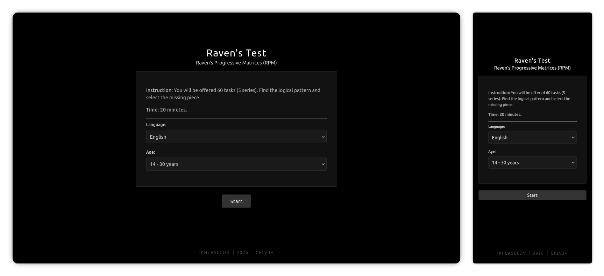
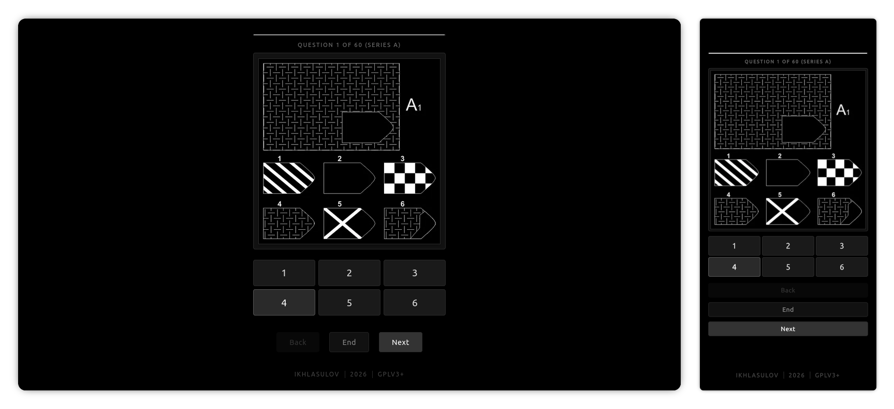

<p align="center">
  
</p>

# Open RPM

A lightweight, browser-based implementation of Raven's Progressive Matrices (IQ Test).

**Live demo:** <https://ikhlasulov.github.io/open-rpm-web/>

[](https://www.gnu.org/licenses/gpl-3.0)
[](https://www.javascript.com/)
[](https://developer.mozilla.org/en-US/docs/Web/HTML)

## Overview

**Open-RPM** is a client-side web application designed to administer the standard Raven's Progressive Matrices test. Built using vanilla JavaScript, HTML5, and CSS3, it prioritizes performance, privacy, and accessibility without relying on external frameworks.

<p align="center">
  
</p>

The application features an adaptive scoring algorithm that adjusts IQ estimates based on the user's age group, along with robust support for multiple languages and responsive layouts.

## Features

- **Adaptive Scoring Engine**: Calculates IQ using a normative database and spline interpolation for precision.
- **Age-Adjusted Results**: Normalizes scores based on specific demographic data (ages 14–60+).
- **Multilingual Interface**: Full localization support for English, Russian, and Indonesian.
- **Privacy Focused**: Executes entirely in the browser. No data is transmitted to external servers.
- **Responsive UI**: A clean, dark-themed interface optimized for desktop and mobile viewports.
- **Slow-Connection Friendly**: ~37 KB on the first visit (gzip, including the first matrix), adaptive image prefetching, and offline support via a service worker.

## Algorithm Details

The scoring system utilizes a pre-defined normative distribution. Raw scores are converted to a base IQ using cubic spline interpolation. The final score is then adjusted by an age percentage factor to comply with standard psychometric practices.

<p align="center">
  
</p>

Reliability is calculated by comparing the user's performance in Series A (the easiest series) against expected deviations. Significant anomalies may flag the result as potentially unreliable due to misunderstanding or inattention.

## Documentation

The logic, normative data, and scoring standards of this test are strictly derived from the clinical manual:

- [Тест Равена. Шкала прогрессивных матриц.](README/Тест_Равена._Шкала_прогрессивных_матриц..pdf)

This document contains the detailed breakdown of the 5 series, correct answer keys, normative distributions, and IQ conversion tables used in this application.

## Performance

The site is tuned for very slow connections:

- **Fonts are subset** into `ubuntu-latin.woff2` and `ubuntu-cyrillic.woff2` (~11 KB and ~7 KB) with `unicode-range`, so the browser downloads only the alphabet it renders. The original `fonts/ubuntu.ttf` is kept only as the build source.
- **Matrices load on demand.** Only the current question and a few neighbours are prefetched during idle time; on `2g` connections or with data-saver enabled, prefetching is disabled entirely.
- **No blob cache.** Images go through the normal browser cache, so going back and forth does not keep 60 decoded SVGs (and 60 blob URLs) in memory.
- **One request for the app shell.** `style.css` and the JavaScript bundle are inlined into `index.html`.
- **Offline / instant repeat visits.** `sw.js` precaches the shell and caches matrices and fonts cache-first. The cache version is a content hash, so any change invalidates it automatically.

Measured cold load with Chromium throttled to Slow 3G (400 kbit/s, 400 ms RTT): **~37 KB transferred and LCP ≈ 0.6 s**, against ~280 KB after 8 s and ~700–900 KB in total for the previous version.

### Build

`index.html`, `sw.js` and the WOFF2 files are generated. Edit the sources (`style.css`, `script.js`, `translations.js`, `answers.js`, `index.html`) and rebuild:

```bash
python3 -m venv .venv
.venv/bin/pip install -r tools/requirements.txt
.venv/bin/python tools/build.py
```

The script subsets the font, verifies that no character used by the UI is missing, inlines the assets, and bumps the service worker cache version. The generated blocks in `index.html` are delimited by `<!-- build:css -->` and `<!-- build:js -->` markers; edit `style.css` and the JavaScript sources, never the inlined copies.

Use `--check` in CI to make sure generated files are up to date:

```bash
.venv/bin/python tools/build.py --check
```

If `fonttools` is not installed, the build keeps the existing WOFF2 files and only regenerates the HTML and the service worker.

## License

This project is licensed under the **GNU General Public License v3.0 or later**. See the [LICENSE](LICENSE) file for details.

## Contributing

Contributions are welcome.
